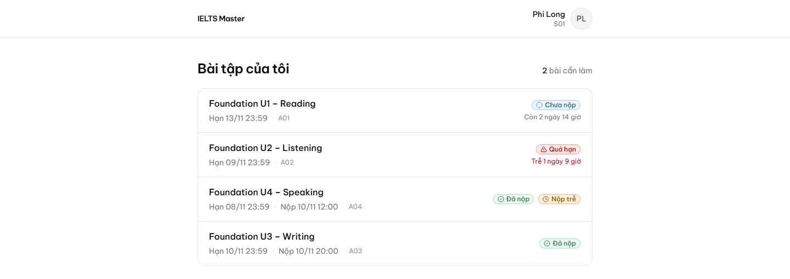
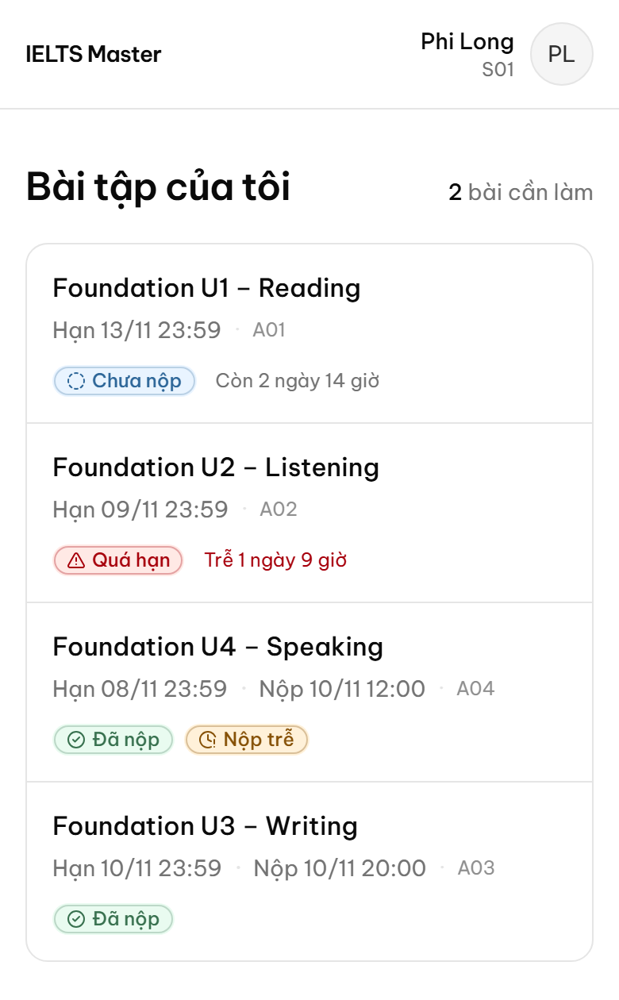

# Bài tập của tôi

Danh sách bài tập cho học viên S01 của IELTS Master. Next.js 16, React 19, TypeScript, shadcn/ui. Không có database, không gọi mạng ra ngoài.

## Chạy

```bash
npm install
npm run dev
```

Mở http://localhost:3000. Trang chủ chưa có phiên nên hiện nút đăng nhập. Bấm nút đó, hoặc mở http://localhost:3000/login, để tạo phiên S01. Đổi sang S02 bằng http://localhost:3000/login?as=s02.

## Giao diện

Máy tính, 1440px:



Điện thoại, 390px:



## Kiểm tra

```bash
npm test          # 38 test
npm run typecheck
npm run lint
npm run build
```

Mỗi file test lo một phần: `brief.test.ts` đối chiếu dữ liệu seed với bảng trong đề, `assignment-status.test.ts` kiểm bốn trạng thái và ranh giới thời gian, `session.test.ts` kiểm việc lọc theo học viên, `format.test.ts` kiểm định dạng ngày giờ, `clock.test.ts` kiểm mốc giả lập, `app/login/route.test.ts` kiểm route cấp phiên.

Kiểm API bằng tay khi server đang chạy:

```bash
curl -i http://localhost:3000/api/assignments
curl -H "Cookie: im_session=sess-01-demo" http://localhost:3000/api/assignments
curl -H "Cookie: im_session=sess-01-demo" "http://localhost:3000/api/assignments?studentId=S02"
```

Lệnh đầu trả `401`. Hai lệnh sau trả bốn bài của S01.

## Kết quả tại mốc 11/11/2026 09:00 GMT+7

| ID | Bài | Hạn nộp | Trạng thái |
| --- | --- | --- | --- |
| A01 | Foundation U1 – Reading | 13/11 23:59 | Chưa nộp |
| A02 | Foundation U2 – Listening | 09/11 23:59 | Quá hạn |
| A04 | Foundation U4 – Speaking | 08/11 23:59 | Đã nộp + Nộp trễ |
| A03 | Foundation U3 – Writing | 10/11 23:59 | Đã nộp |

B01 của S02 không xuất hiện. Danh sách sắp theo khả năng hành động: bài chưa quá hạn đứng trước, rồi bài đã lỡ hạn, cuối cùng là bài đã xong.

## Cách tránh lộ dữ liệu S02

Route `/api/assignments` không đọc mã học viên từ query hay path. Danh tính đến từ cookie `im_session` đặt `httpOnly`, nên JavaScript phía client không đọc hay sửa được. Không có phiên hợp lệ thì trả `401` thay vì mảng rỗng, để lỗi xác thực không trông giống "học viên chưa có bài tập".

`listAssignmentsForStudent()` trong `lib/session.ts` là chỗ duy nhất đọc dữ liệu. Nó nhận `studentId` từ `Session` mà server đã xác thực. `lib/assignments.ts` để S01 và S02 chung một mảng phẳng, và bộ lọc chạy trên mảng đó.

`app/page.tsx` là Server Component: lọc xong mới gửi HTML xuống, nên B01 không nằm trong payload về trình duyệt.

Kiểm tra thủ công: thêm `?studentId=S02` vào URL khi đang có phiên S01 vẫn chỉ trả bài của S01.

## Mốc thời gian giả lập

`SIMULATED_NOW` trong `lib/clock.ts` là hằng số `2026-11-11T09:00:00+07:00`. `getStatus(assignment, now)` là hàm thuần, nhận thời điểm qua tham số chứ không đọc đồng hồ hệ thống. Một test khẳng định `SIMULATED_NOW.getTime() !== Date.now()`, nên nếu ai đổi sang giờ thật thì test đỏ.

Hiển thị dùng `Intl.DateTimeFormat` với `timeZone: "Asia/Ho_Chi_Minh"` tường minh, nên máy chạy ở UTC vẫn ra `23:59`.

## Cấu trúc

```text
app/
  api/assignments/route.ts   GET /api/assignments
  login/route.ts             tạo cookie phiên giả lập
  page.tsx                   trang danh sách, Server Component
  layout.tsx                 font, ngôn ngữ, metadata
components/
  assignment-row.tsx         một dòng bài tập
  status-badge.tsx           nhãn trạng thái kèm icon
  ui/                        component shadcn
lib/
  clock.ts                   mốc giả lập và múi giờ
  assignments.ts             dữ liệu thô của S01 và S02
  assignment-status.ts       quy tắc trạng thái
  session.ts                 phiên giả lập và hàm lọc
  format.ts                  định dạng ngày giờ
  initials.ts                chữ cái đầu cho avatar
```

## Phần chưa làm

Trang không có hành động nào: không mở được bài, không nộp bài, không lọc, không dùng bàn phím. Đề chỉ yêu cầu hiển thị. Nếu làm tiếp, việc đầu tiên là bọc tiêu đề bài trong link tới trang chi tiết.

`/login` là công cụ của bài test, tạo cookie mà không có mật khẩu hay xác thực. Trong hệ thống thật phải thay bằng đăng nhập có kiểm chứng và chặn route này ở môi trường production. Phiên cũng lưu trong bộ nhớ, mất khi restart server.

Phân trang và lọc theo trạng thái chưa có vì chỉ bốn bài. Chưa có e2e test; phần render chỉ kiểm bằng ảnh chụp ở 320, 390, 768, 1440 và 1920px.
